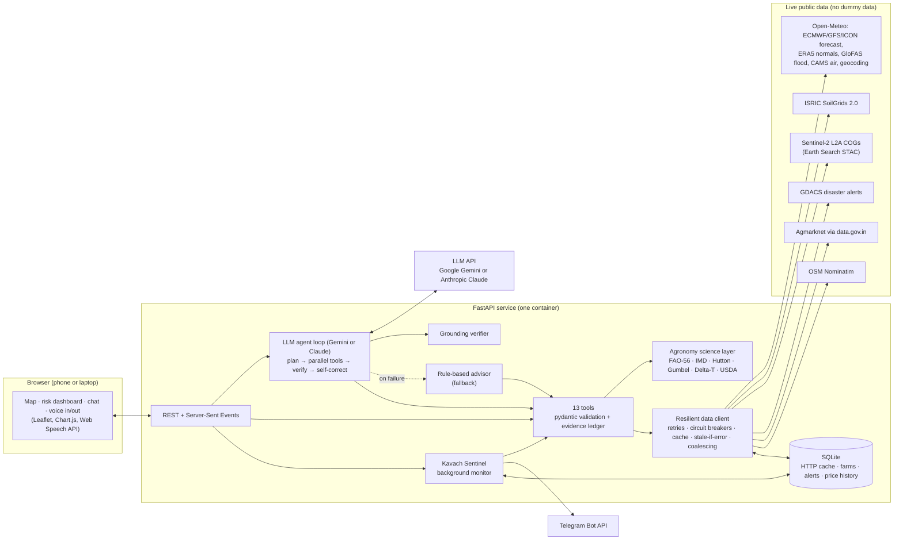
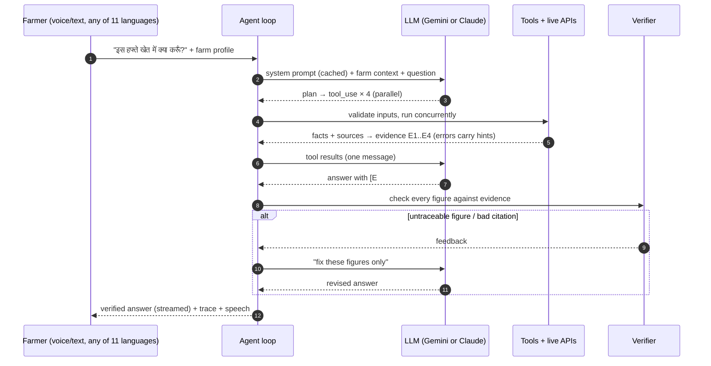

# 🛡️ KhetKavach (खेत कवच): an agentic climate-risk shield for every farm

**Forge Gen AI Buildathon · Theme 2: Climate, Resource Infrastructure & Global Supply Resilience**
Problem tracks: *Multilingual Agritech & Resource Advisory Assistant* + *Predictive Climate & Micro-Location risk engine*

KhetKavach gives an Indian smallholder a personal agronomist and climate-risk analyst for their **exact field**.
It fuses **10 live public data services** (weather models, 30-year climate normals, river-flood ensembles, soil maps,
Sentinel-2 satellite imagery, UN disaster alerts, government mandi prices) with **published agronomic science**
(FAO-56, IMD criteria, Hutton late-blight rules). An **LLM agent (Google Gemini or Anthropic Claude)** then plans, calls tools in parallel,
self-corrects, and answers **by voice in 11 Indian languages**. Every figure in its answer is **machine-verified
against the live evidence** before the farmer sees it.

| | |
|---|---|
| 🌐 Live app | `<add your Hugging Face Spaces / Render URL>` |
| 🎬 Demo video | `<add your 2–3 min video link>` |
| 📊 Pitch deck | [docs/PITCH_DECK.md](docs/PITCH_DECK.md) |
| 🧭 Architecture deep-dive | [docs/ARCHITECTURE.md](docs/ARCHITECTURE.md) |

---

## 1. The problem

* India has about **146 million operational holdings, 86% of them small or marginal** (Agriculture Census 2015-16). Most farm without
  an agronomist, and climate volatility (erratic monsoons, heatwaves, flash floods) now decides many of their seasons.
* Official agromet advisories exist, but they are issued for whole districts or blocks, twice a week, in bulletin form. They do not know
  *this* field's crop stage, soil or irrigation method, and they cannot be asked a follow-up question.
* The data that would answer the farmer's real questions is public but scattered across portals, units and formats a farmer will never
  combine: ensemble river forecasts, 30-year normals, soil water-holding maps, satellite vigour, mandi prices.
  * *"Should I irrigate tomorrow or wait for the rain?"*
  * *"Can I spray today?"*
  * *"Is this heat dangerous for my wheat at flowering?"*
  * *"Where will I get the best price?"*
* Generic chatbots answer these questions confidently from stale training data. In agriculture, that hallucination costs a crop.

**Target users:** smallholder farmers (directly, by voice), FPOs, Krishi Vigyan Kendra (KVK) staff and agri-extension workers who
advise hundreds of farmers, and district disaster cells monitoring farms at risk.

## 2. What KhetKavach does

| Capability | What the farmer gets |
|---|---|
| 🗺️ **Field-level risk dashboard** | Tap the field on a map. KhetKavach runs 12 live analyses concurrently and streams each card as it finishes: weather + IMD hazards, rain/heat vs 1991-2020 normal, crop stress and disease weather, an FAO-56 irrigation schedule, spray windows, a river-flood outlook, soil, mandi prices, disaster alerts, air quality and Sentinel-2 NDVI. |
| 🤖 **AI agronomist (Gemini or Claude agent)** | Ask in text or by voice. The agent plans, calls tools in parallel, recovers from tool errors using their hints, and answers in the farmer's language with `[E#]` citations to the evidence. |
| ✅ **Grounding verifier** | Before an answer is shown, every data figure (mm, °C, %, km/h, m³/s, ₹, L) is checked against the tool evidence. Anything untraceable sends the agent back to self-correct once. The UI shows "✔ 9/9 data figures verified against live sources". |
| 🔁 **Live agent trace** | Judges and farmers can watch the reasoning summary, each tool call with its inputs, timing, sources and evidence ID, the verification step and any self-correction. |
| 🛰️ **Satellite crop vigour** | Cloud-masked Sentinel-2 NDVI for a 150 m window around the field, its recent trend, and a comparison with the same period last year, read directly from Cloud-Optimised GeoTIFFs. |
| 📔 **Weekly field diary** | Each week the farmer sends one crop photo and taps a few answers (leaf colour, pests seen, irrigated/sprayed/fertilised dates, a note). The AI compares the photo with last week's and returns structured findings: growth stage seen vs expected, rough canopy cover, water stress, weeds, possible symptoms with a likelihood, and what to check in the field. The agent cites the diary as evidence, the reported irrigation date feeds the water balance, and the field size turns litres per acre into litres for the whole field. |
| 📣 **Kavach Sentinel (autonomous)** | Register a farm once. A background monitor re-analyses it every few hours, raises de-duplicated alerts (weekly photo reminder, likely symptom in the latest photo, heavy rain, heat/cold waves, crop stress, irrigation due or hold, river flood, nearby disasters), writes them in the farmer's language and pushes them to **Telegram**. |
| 🗣️ **Multilingual voice** | 11 languages (English, Hindi, Marathi, Bengali, Telugu, Tamil, Gujarati, Kannada, Malayalam, Punjabi, Odia) for answers. Speech in and out uses the browser's Web Speech API (no extra key). The UI itself is in English and Hindi. |
| 🧯 **Never a blank screen** | If the AI is unreachable, rate-limited, slow or misconfigured, a rule-based advisor answers from the same live evidence. If one data source is down, only its card degrades. |

## 3. Why it is different (USP)

1. **Grounded by construction, verified after the fact.** Tools return compact, unit-labelled facts with provenance, and the agent must
   cite them. A deterministic verifier then rejects untraceable figures. This is the opposite of an off-the-shelf chatbot.
2. **Real agronomy, not prompt engineering.** The irrigation advice is an FAO-56 root-zone water balance on this field's soil (SoilGrids
   field capacity and wilting point) with climate-adjusted Kc and water-stress Ks. Spray windows use the Delta-T method. Flood alerts
   use Gumbel 2/5/20-year return levels from 40 years of GloFAS reanalysis, mirroring GloFAS alert classes.
3. **Saves water and money.** "Hold irrigation: 72 mm rain expected" comes with the litres per acre the farmer saves by waiting.
4. **Agentic end to end.** It plans multi-step tool use, self-heals connector quirks, self-corrects answers, and runs autonomously
   (Sentinel) with outbound alerts.
5. **Zero dummy data.** Every number comes from a live API or an official open dataset at request time. With the internet off, cards say
   "unavailable" or show the last good value clearly labelled *stale*. Nothing is ever invented.
6. **Personal, not generic.** A weekly photo diary lets the AI see the actual field: what stage it is really at, whether leaves
   are spotting, whether weeds are spreading. Advice changes with what the farmer sees, not just with the calendar.

## 4. Architecture



### How one question is answered



If the LLM is unreachable, slow, rate-limited or misconfigured, the turn is rolled back and the **rule-based advisor** answers from the same
tools. All of this is shown live in the UI's *Agent trace* panel. See [docs/ARCHITECTURE.md](docs/ARCHITECTURE.md) for the state machine,
module map and failure matrix.

## 5. Live data sources

| Source | Used for | Key needed |
|---|---|---|
| [Open-Meteo Forecast](https://open-meteo.com/en/docs) (ECMWF IFS, NCEP GFS, DWD ICON) | 16-day hourly/daily forecast + last 30 days, FAO-56 ET₀, soil moisture | no |
| [Open-Meteo Historical](https://open-meteo.com/en/docs/historical-weather-api) (ERA5) | 1991-2020 daily climate normals and percentiles | no |
| [Open-Meteo Flood](https://open-meteo.com/en/docs/flood-api) (Copernicus GloFAS v4) | 30-day ensemble river discharge + 1984-present reanalysis | no |
| [Open-Meteo Air Quality](https://open-meteo.com/en/docs/air-quality-api) (Copernicus CAMS) | AQI, PM2.5, PM10, O₃, NO₂ | no |
| [Open-Meteo Geocoding](https://open-meteo.com/en/docs/geocoding-api) (GeoNames) | Place search | no |
| [ISRIC SoilGrids 2.0](https://rest.isric.org/soilgrids/v2.0/docs) | Texture, pH, organic carbon, N, CEC, bulk density, water retention (250 m) | no |
| [Copernicus Sentinel-2 L2A](https://registry.opendata.aws/sentinel-2-l2a-cogs/) via [Earth Search STAC](https://earth-search.aws.element84.com/v1) | NDVI crop vigour (cloud-masked) | no |
| [GDACS](https://www.gdacs.org) (UN OCHA / EC JRC) | Active cyclones, floods, earthquakes, droughts, wildfires | no |
| [Agmarknet via data.gov.in](https://data.gov.in/resource/current-daily-price-various-commodities-various-markets-mandi) | Daily wholesale mandi prices (₹/quintal) | free key |
| [OSM Nominatim](https://nominatim.org) | Village / district / state for a coordinate | no |
| [Gemini API](https://ai.google.dev) (free tier) **or** [Claude API](https://docs.claude.com) | Reasoning, planning, language | one of the two |
| [Telegram Bot API](https://core.telegram.org/bots/api) | Pushing Sentinel alerts | optional |

The only constants in the code are **published science**: FAO-56 crop coefficients, stage lengths and depletion fractions, IMD thresholds,
and disease-favourable weather windows. Each is cited in [`app/agronomy/`](app/agronomy). The test fixtures in `tests/fakes.py` are synthetic
API-shaped responses used **only** by the offline test suite; the application never imports them.

## 6. Robustness (built for a live demo)

* **Network:** bounded retries with exponential backoff and jitter, `Retry-After` support, per-source timeouts.
* **Fail fast:** a circuit breaker per source opens after repeated failures, so a dead API doesn't slow every request.
* **Caching:** SQLite TTL cache sized to each source's update rhythm (30 min forecast, 30 days for normals, 90 days for soil). If an
  upstream is down, the last good response is served and visibly flagged **stale**.
* **Coalescing:** concurrent identical requests share one upstream call (12 tools need the forecast; it is fetched once).
* **Self-healing connectors:**
  * The mandi connector tries both data.gov.in filter conventions, maps crop names to Agmarknet's commodity names and re-filters every row.
  * The flood connector falls back from a 9-cell river search to a single cell.
  * The soil connector falls back to Saxton & Rawls pedotransfer functions.
  * The STAC search falls back to an alternative collection.
* **Agent resilience:**
  * SDK retries for transient errors and rate limits; on Claude, Anthropic's **server-side refusal fallbacks** (`fallbacks: "default"`);
    on Gemini, an automatic model fallback chain if the configured model is not available to the key.
  * A compatibility retry if optional request features are rejected.
  * Turn timeouts, and history rollback so a session never breaks.
  * The rule-based advisor as the last line of defence.
* **Input validation:** pydantic on every API request and every tool call. Invalid tool inputs go back to the model with the exact problems so
  it can correct itself.
* **Photo privacy:** photos are shrunk in the browser, then re-encoded on the server without any metadata (no GPS).
  They are served only by an unguessable per-entry link, and the farmer can delete any check-in. A failed or unavailable
  photo analysis never blocks saving the farmer's own observations.
* **Safety:**
  * A static system prompt; tool output is treated as data, not instructions.
  * No pesticide doses; the agent refers farmers to labels and the local KVK.
  * Per-IP rate limits protect the API budget on a public URL.

## 7. Quick start (local)

**Requirements:** Python 3.11+ and an internet connection. For the AI agent, set **one** key: `GEMINI_API_KEY` (free tier, from
[Google AI Studio](https://aistudio.google.com/apikey)) or `ANTHROPIC_API_KEY`. Without a key the rule-based mode is used.

```bash
git clone https://github.com/Sameer6556/code-benders.git
```

```bash
cd code-benders
```

```bash
python -m venv .venv && source .venv/bin/activate
```

```bash
pip install -r requirements-dev.txt
```

```bash
cp .env.example .env
```

Edit `.env` and set `GEMINI_API_KEY` (or `ANTHROPIC_API_KEY`). Also set `DATA_GOV_IN_API_KEY` (free at data.gov.in) for full
mandi coverage. With `KK_LLM_PROVIDER=auto`, Claude is used if its key is set, otherwise Gemini.

```bash
uvicorn app.main:app --reload --port 8000
```

Open <http://localhost:8000>. Tap your field on the map, pick the crop and sowing date, then press **Analyse my farm**. Switch to **Ask the AI
agronomist** and try a suggestion, or press 🎙️ and speak.

### Verify every live integration (do this before the demo)

```bash
python scripts/smoke_test.py --llm
```

This calls all 12 data tools for three farms (Nashik onion, Ludhiana wheat, Patna rice near the Ganga), prints each headline with its latency,
then runs one real agent turn with your AI key (live tool calls, Hindi answer, verification), and exits non-zero if a core
source or the agent fails.

### Run the tests

```bash
pytest -q
```

91 offline tests cover the agronomy formulas (with published reference values), the verifier (incl. Devanagari digits), HTTP resilience
(retry, circuit breaker, stale cache, coalescing), every tool end to end, real NDVI reads from GeoTIFFs, both agent loops, Claude and Gemini (parallel tools,
self-correction, tool-error recovery, outage and rate-limit fallback, model fallback, compat retry) and the HTTP API including Sentinel alert de-duplication.

## 8. Deploy

The app is one Docker container listening on `$PORT` (default 7860).

**Hugging Face Spaces (free, recommended):**

1. Create a new Space and choose the **Docker** SDK.
2. Push this repository to the Space.
3. Add this front matter at the top of the Space's `README.md`:

   ```yaml
   ---
   title: KhetKavach
   emoji: 🛡️
   colorFrom: green
   colorTo: yellow
   sdk: docker
   app_port: 7860
   ---
   ```

4. In the Space settings, add `GEMINI_API_KEY` or `ANTHROPIC_API_KEY` (and optionally `DATA_GOV_IN_API_KEY` and `TELEGRAM_BOT_TOKEN`)
   as **secrets**.

**Render:** choose New → Blueprint → this repo (uses [`render.yaml`](render.yaml)), then set the secrets. Free instances sleep when idle, so
open the URL a minute before judging.

**Any Docker host:**

```bash
docker build -t khetkavach .
```

```bash
docker run -p 7860:7860 --env-file .env khetkavach
```

## 9. Configuration

| Variable | Default | Purpose |
|---|---|---|
| `GEMINI_API_KEY` | – | Enables the Gemini agent (free tier at aistudio.google.com) |
| `KK_GEMINI_MODEL` | `gemini-flash-latest` | Gemini model (falls back to `gemini-2.5-flash` if unavailable) |
| `ANTHROPIC_API_KEY` | – | Enables the Claude agent |
| `KK_MODEL` | `claude-opus-5-5` | Claude model for the agent and alert wording |
| `KK_LLM_PROVIDER` | `auto` | `auto` (Claude if its key is set, else Gemini), `gemini`, `claude` or `rules` |
| `KK_EFFORT` | `medium` | Claude reasoning effort (`low` = faster/cheaper, `high` = deeper) |

> **Gemini free tier:** it has per-minute and per-day request limits. One farmer question uses 2–4 model calls. If a limit is hit
> mid-demo, the rule-based advisor answers automatically and the trace says why. Under Google's terms, free-tier prompts may be used to
> improve Google's products, so don't send personal data.
| `DATA_GOV_IN_API_KEY` | public sample key | Agmarknet mandi prices (sample key: max 10 records) |
| `TELEGRAM_BOT_TOKEN` | – | Push Sentinel alerts to farmers' Telegram |
| `KK_SENTINEL_INTERVAL_MIN` | `180` | Background monitoring interval (0 = off) |
| `KK_SATELLITE` | `1` | Sentinel-2 NDVI analysis on/off |
| `KK_DB_PATH` | `./data/khetkavach.db` | SQLite file (cache, farms, alerts) |
| `KK_AGENT_TIMEOUT` | `180` | Seconds before an agent turn falls back to rules |

## 10. Project structure

```
app/
├── main.py              FastAPI app + lifespan wiring
├── config.py            environment settings
├── http.py              resilient data client (retry, circuit breaker, cache, stale-if-error, coalescing)
├── db.py                SQLite: HTTP cache, farms, alerts, mandi price history
├── evidence.py          evidence ledger (E1, E2, …) with provenance
├── schemas.py           request models (FarmProfile, ChatRequest, …)
├── sources/             one connector per live API (I/O + parsing only)
├── agronomy/            pure science: water (FAO-56), spray (Delta-T), stress (IMD, Hutton),
│                        climate (normals), hydrology (Gumbel), soil (USDA, Saxton-Rawls), crops (constants)
├── tools/               13 agent/dashboard tools, registry (schemas, validation, execution)
├── agent/               shared agent core (base.py), Claude and Gemini loops, prompts, verifier, sessions,
│                        provider factory, rule-based fallback
├── diary/               field diary: photo intake (resize, EXIF/GPS strip), findings schema, check-in service
├── sentinel/            autonomous monitor + Telegram delivery
├── api/                 REST + SSE routes, dashboard streamer
└── static/              single-page app (vanilla JS modules, vendored Leaflet + Chart.js)
scripts/smoke_test.py    live end-to-end integration check
tests/                   91 offline tests (fakes.py = test-only API stand-ins)
docs/                    architecture, pitch deck, demo script, submission text, judge Q&A
```

## 11. API

| Method | Path | Description |
|---|---|---|
| GET | `/api/health` | AI status, per-source health (ok / degraded / circuit_open), Sentinel status |
| GET | `/api/meta` | Crops, languages, irrigation methods |
| GET | `/api/geocode?q=` · `/api/reverse?lat=&lon=` | Place search / reverse geocoding |
| POST | `/api/dashboard` | **SSE**: one `section` event per analysis, then a `summary` |
| POST | `/api/chat` | **SSE**: `session`, `step`, `thinking`, `tool_start`, `tool_end`, `text`, `verification`, `notice`, `final` |
| GET/POST/DELETE | `/api/farms` | Sentinel farm registry |
| POST | `/api/sentinel/scan[?farm_id=]` | Run the monitor now |
| GET | `/api/alerts` | Alert feed |
| POST | `/api/diary` | Weekly check-in: multipart `farm` (JSON), `observations` (JSON), optional `photo` |
| GET | `/api/diary?lat=&lon=&crop=&sowing_date=` | Check-ins for a field, newest first, with the next due date |
| GET/DELETE | `/api/diary/photo/{token}` · `/api/diary/{token}` | Photo by unguessable token · delete a check-in |

Interactive docs: `/docs` (OpenAPI).

## 12. Limitations and roadmap

* Weather, soil and flood values are model outputs on 1–25 km grids, so they are advisory. Soil comes from 250 m maps, not a lab test.
  The app says so in every relevant card.
* Disease entries flag *favourable weather*, not confirmed infection. Pest models are on the roadmap.
* Mandi prices exclude transport cost. Next steps are a distance-aware net-price ranking and price trend forecasting from the history
  KhetKavach accumulates.
* **Roadmap:**
  * WhatsApp/IVR delivery for feature phones.
  * Server-side Indic TTS/STT (Bhashini) for devices without local voices.
  * Farm polygons instead of points.
  * IMD district warnings and ISRO Bhuvan layers once API access is granted.
  * Yield-risk scoring from NDVI trajectories.

## 13. Team & licence

Team **Code Benders**. Source code under the [MIT licence](LICENSE). Leaflet (BSD-2) and Chart.js (MIT) are vendored in `app/static/vendor`
with their licences. Data © their providers: Open-Meteo (CC BY 4.0), Copernicus (ECMWF, CAMS, GloFAS, Sentinel), ISRIC (CC BY 4.0),
GDACS, OGD India, and OpenStreetMap contributors (ODbL).

> KhetKavach is an advisory tool. Always confirm critical decisions with your local Krishi Vigyan Kendra or agriculture officer.
