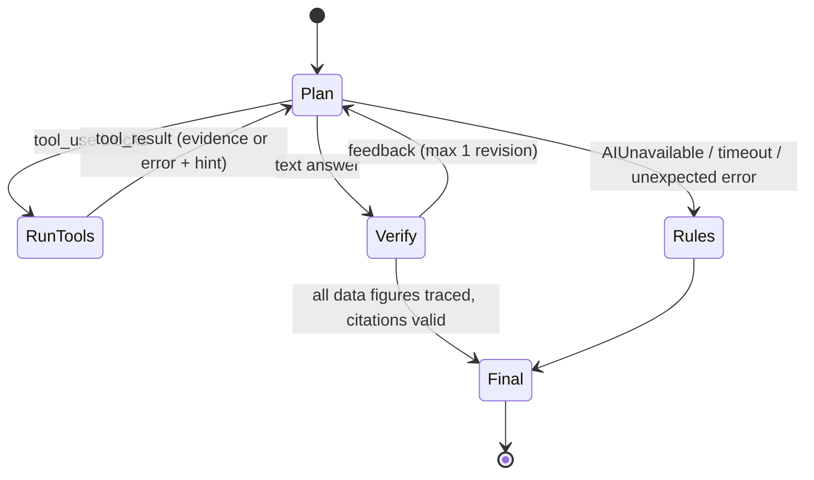

# KhetKavach architecture

This document explains how KhetKavach works end to end. It covers the data flow, the agent's state machine, each module's job, and how
every failure is handled. Every team member should be able to walk a judge through it.

## 1. Layers

| Layer | Package | Responsibility | Talks to |
|---|---|---|---|
| Presentation | `app/static` | Map, dashboard cards/charts, chat, agent trace, voice, Sentinel UI | API over REST + SSE |
| API | `app/api` | Validation, rate limiting, SSE streaming, farm/alert CRUD | agent, tools, sentinel |
| Agent | `app/agent` | Claude tool-use loop, prompts, verifier, sessions, rule-based fallback | Claude API, tools |
| Autonomy | `app/sentinel` | Periodic farm sweeps, alert rules, wording, Telegram delivery | tools, Claude, DB |
| Tools | `app/tools` | 13 capabilities = live data + science; input models; evidence capture | sources, agronomy |
| Science | `app/agronomy` | Pure functions: FAO-56, Delta-T, IMD, Hutton, Gumbel, normals, soil | nothing (no I/O) |
| Connectors | `app/sources` | One module per API: request + defensive parsing (+ self-healing) | `DataClient` |
| Infrastructure | `app/http.py`, `app/db.py`, `app/evidence.py` | Resilient HTTP, SQLite, evidence ledger | internet, disk |

The science layer has **no I/O**, so it is unit-tested against published reference values (e.g. Stull's wet-bulb example and
Saxton-Rawls loam values). Connectors do **only** I/O and parsing, which keeps them replaceable.

## 2. Request flows

### 2.1 Risk dashboard (`POST /api/dashboard`, SSE)

1. The browser posts the `FarmProfile` (lat, lon, crop, sowing date, irrigation, language). Pydantic validates it: known crop, plausible
   dates, coordinates in range.
2. `stream_dashboard` starts 12 tool runs concurrently and emits one `section` event per tool **as it completes**
   (`asyncio.as_completed`), so fast cards appear first.
3. Each tool fetches what it needs through `DataClient`. Identical concurrent requests are coalesced, so the 16-day forecast is fetched
   once for all weather-based tools.
4. A final `summary` event ranks the risks by level (severe > high > moderate/watch).

### 2.2 Chat with the agent (`POST /api/chat`, SSE)

1. `SessionStore` returns the conversation for this farm. A changed crop, location or language starts a new session.
2. **First turn:** a `<farm_context>` block (today's date, coordinates, crop, sowing date, irrigation, reply language) is prepended to
   the question. The system prompt itself is static, so the tools + system prefix is cached across all users.
3. **Loop** (at most `KK_MAX_AGENT_STEPS`):
   1. Stream a Claude request (`claude-opus-5-5`, adaptive thinking with summarized display, `effort` configurable, server-side refusal
      fallback, prompt caching). Thinking summaries and text deltas are relayed to the UI as they arrive.
   2. If Claude requests tools, every `tool_use` is validated with its pydantic model and executed **concurrently**. All results go back in
      **one** user message. Failures come back as `is_error` results with a `hint`; for example, the mandi tool lists the commodities
      traded today, so Claude can retry with the right name.
   3. If Claude answers, the verifier checks it. On failure, a `<verification_feedback>` message is appended (history stays append-only)
      and Claude revises once.
   4. On the last allowed step, `tool_choice: none` forces a final answer.
4. **Final event:** the answer, verification report, evidence list (with sources), token usage and mode (`ai` / `rules`).

### 2.3 Agent state machine

### 2.4 Sentinel sweep

Every `KK_SENTINEL_INTERVAL_MIN` minutes, or when `POST /api/sentinel/scan` is called:

1. For each registered farm, run weather, crop risk, irrigation, flood and disaster tools.
2. Apply `derive_alerts`:
   * IMD hazards within 3 days
   * crop risk at high or above
   * irrigation due, or "hold for rain", within 2 days
   * a river flood at moderate or above
   * an Orange/Red GDACS event within 300 km
3. Word each alert in the farmer's language with Claude (low effort). The wording is verified against the alert facts; if it fails, a
   template is used instead.
4. Insert alerts with a `UNIQUE(farm, kind, day)` constraint, so repeated sweeps don't spam the farmer. New alerts are pushed to Telegram.

## 3. The grounding verifier (`app/agent/verifier.py`)

* Normalises Indic digits (Devanagari, Bengali, Gurmukhi, Gujarati, Odia, Tamil, Telugu, Kannada, Malayalam) to ASCII.
* Extracts every number. A number is a **data figure** if a unit (mm, °C, %, km/h, m³/s, kg, L, AQI…) follows it, a currency (₹, Rs)
  precedes it, or it opens a unit range ("28-32 °C").
* Collects every number the model actually saw: evidence data, notes and source timestamps, plus the user's question.
* A data figure is supported if it matches one of those numbers within rounding (±0.51 or ±2.5%). Sign-insensitive, so "42% below"
  matches -42.
* Citations must reference existing evidence IDs, and answers containing data figures must cite something.
* Small integers (counts, list numbers) and dates are reported but never block an answer.

The prompt also forbids computing new numbers. Tools pre-compute totals, gaps, percentages and litres, which makes verification precise.

## 4. Failure matrix

| Failure | Detection | Behaviour the user sees |
|---|---|---|
| Upstream timeout / 5xx / 429 | `DataClient` | Retries with backoff (honours `Retry-After`) |
| Upstream down for long | circuit breaker (4 consecutive failures) | Fails fast for 60 s; health pill turns amber |
| Upstream down, cache exists | stale-if-error | Last good data, badge **stale** with its timestamp |
| Upstream down, no cache | `SourceError` → `ToolError` | That card says "unavailable"; agent told *not to estimate* |
| API format drift | parsers validate shape | Clear "unexpected response format" error; self-healing alternatives tried first |
| Soil API down | irrigation tool | Falls back to FAO-56 Table 19 loam, flagged "assumed / lower confidence" |
| Bad tool input from Claude | pydantic | `is_error` result listing the invalid fields → Claude fixes and retries |
| Claude 400 on optional features | `BadRequestError` | One retry without betas/eager streaming |
| Claude safety decline | `stop_reason: refusal` | Server-side fallback model, else a polite redirect |
| Claude unreachable / bad key / rate limit / timeout | `AIUnavailable` | Turn rolled back; rule-based advisor answers from live tools |
| Client disconnects mid-turn | `CancelledError` | Turn rolled back; session stays valid |
| Abuse of the public URL | per-IP sliding window | HTTP 429 with a friendly message |

## 5. Key design choices

* **Manual agent loop instead of a framework.** We need custom streaming to the UI, parallel execution, evidence capture, verification
  and rollback. That fits in about 200 readable lines with no hidden magic.
* **Tools return facts, not prose.** Compact, unit-labelled JSON keeps the context small, makes citations natural and makes verification
  possible.
* **SSE over WebSockets.** It is one-directional, proxy-friendly, needs no extra dependency, and heartbeats keep hosting proxies from
  closing idle streams.
* **SQLite.** Zero-ops, one file, enough for cache + registry + alerts at hackathon scale. Swap for Postgres when scaling.
* **Vanilla JS modules with vendored libraries.** No build step and no CDN dependency during the live demo.
